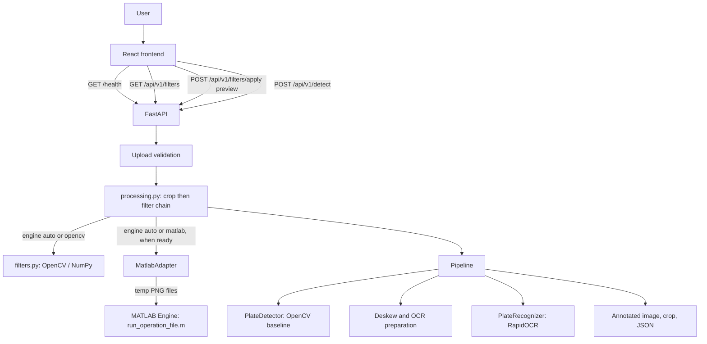
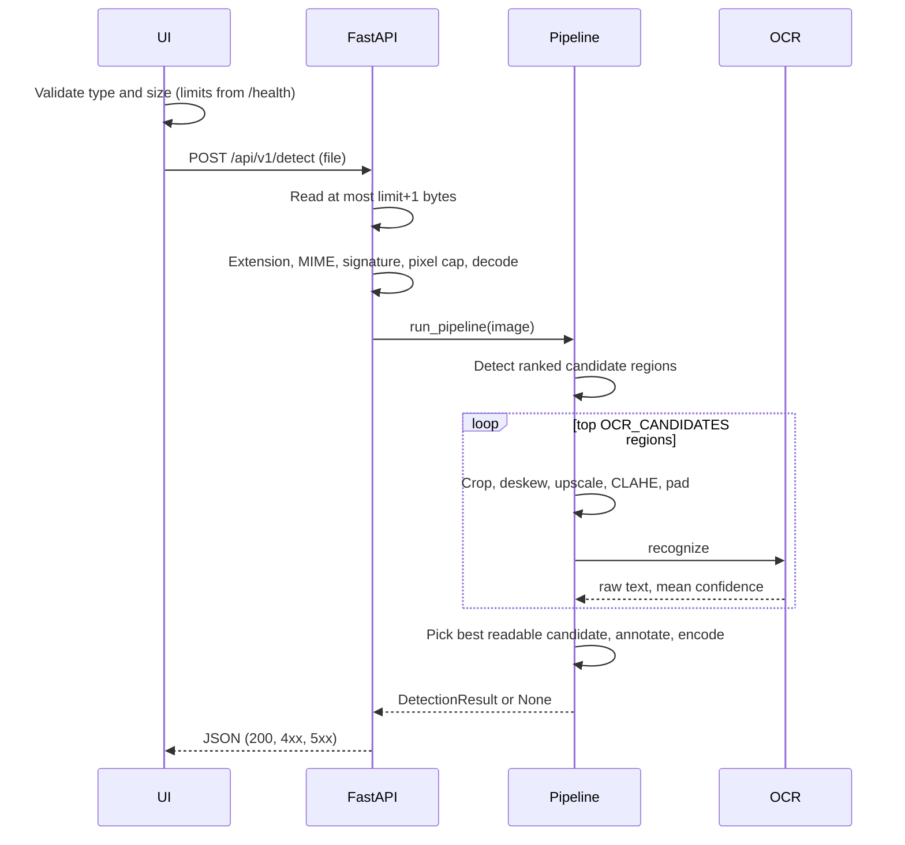

# System architecture

This document describes what is implemented. Items that are planned or untested are labelled.

## 1. Overview

Every request may carry a crop, an ordered filter chain and an engine choice. `filters.py` holds
the catalog (29 operations, ids and parameter ranges); the MATLAB dispatcher uses the same ids.
In `auto` mode a step goes to MATLAB when MATLAB is ready and the operation has a MATLAB version,
otherwise to OpenCV; a failed MATLAB call falls back to OpenCV and is flagged in the response.

## 2. Module responsibilities

| Module | Responsibility |
|---|---|
| `app/main.py` | App factory, CORS, uniform error handlers (no stack traces to clients) |
| `app/api/routes.py` | `/health`, `/api/v1/filters`, `/api/v1/filters/apply`, `/api/v1/detect`; size-limited read; offloads CPU work to a thread pool |
| `app/services/filters.py` | Operation catalog (ids, parameters, ranges) and OpenCV/NumPy implementations of all course filters |
| `app/services/processing.py` | Parses and validates `crop`, `steps`, `engine`; applies crop; runs the chain with engine routing and fallback |
| `app/api/deps.py` | Dependency providers (settings, detector, recognizer, MATLAB, SVM); tests override these |
| `app/core/config.py` | Environment-driven settings |
| `app/core/errors.py` | Typed domain errors mapped to HTTP status and `error_code` |
| `app/services/image_preprocessing.py` | Validation and decoding, grayscale, denoise, CLAHE, resize, deskew, OCR preparation |
| `app/services/plate_detector.py` | `PlateDetector` interface and `ContourPlateDetector` baseline |
| `app/services/svm_plate.py` | HOG features (numpy), `SvmVerifier` (loads `models/plate_svm.npz`) and `SvmPlateDetector`, which wraps any detector and re-ranks or rejects its candidates |
| `app/services/svm_ocr.py` | Character segmentation, glyph features and `SvmCharRecognizer` (a `PlateRecognizer`); loads `models/ocr_svm.npz` |
| `scripts/train_svm_ocr.py` | Offline training of the character SVM on synthetic plates |
| `scripts/train_svm.py`, `scripts/synthetic_scenes.py` | Offline training on synthetic scenes (needs scikit-learn); not used while serving |
| `app/services/plate_recognizer.py` | `PlateRecognizer` interface, `RapidOcrRecognizer`, text normalisation |
| `app/services/pipeline.py` | Orchestration, annotation, data-URL encoding |
| `app/services/matlab_adapter.py` | MATLAB Engine bridge: background start, status, file-based calls to `matlab/api/run_operation_file.m` (real MATLAB call path untested) |
| `app/schemas/detection.py` | Pydantic response models |
| `frontend/src/services/api.js` | The only place that talks to the API; maps responses to UI outcomes |
| `frontend/src/hooks/useDetection.js` | State machine: idle, ready, loading, success, no_plate, error |
| `frontend/src/hooks/usePrepare.js` | Crop, filter chain, engine, reference image and preview state |
| `frontend/src/features/prepare/*` | Crop editor, filter panel, preview tabs, method comparison |
| `frontend/src/features/detection/*` | Upload panel, detect bar, results panel, skeleton, result view |

## 3. Request flow

## 4. Computer-vision pipeline

1. **Decode** (`validate_and_decode`): OpenCV decode after Pillow header checks; EXIF orientation honoured by OpenCV.
2. **Downscale** the working copy to `DETECTOR_MAX_SIDE`; coordinates are mapped back to the original.
3. **Grayscale and bilateral denoise**: smooths texture while keeping character edges.
4. **Black-hat and top-hat** with a rectangular kernel sized to roughly one character (image width / 75). Black-hat keeps dark strokes on a light plate, top-hat the reverse.
5. **Horizontal Scharr gradient**, normalised, Gaussian blur, wide morphological closing so neighbouring characters merge into one blob, Otsu threshold, erode and dilate to remove specks.
6. **Contour filter**: aspect ratio 1.8 to 8, area 0.08 to 25 percent of the image, minimum 40 by 12 px.
7. **Ranking score** in [0, 1]: 0.30 aspect closeness to 4:1 (Gaussian), 0.30 Canny edge density (saturating at 18 percent), 0.20 gray standard deviation (saturating at 55), 0.20 contour fill ratio. Candidates below 0.30 are dropped; overlapping candidates are removed by non-maximum suppression (IoU 0.35).
8. **Padding** by 12 percent of width and 25 percent of height, because the mask hugs the characters, not the plate margin.
9. **Deskew** the crop: minimum-area rectangle of the character components (components touching the crop border are ignored); rotations under 0.5 or over 15 degrees are ignored. Full perspective correction is not implemented.
10. **OCR preparation**: upscale to at least 96 px high (cubic), CLAHE, constant border padding.
11. **OCR** on up to `OCR_CANDIDATES` regions; a result is plausible with at least 4 alphanumeric characters. The best plausible one is chosen by `0.5 * region score + 0.5 * OCR confidence` (0.5 if the engine gives none).
12. **Normalisation**: upper case, keep A-Z and 0-9 only. No character substitution. Raw OCR text is returned separately.
13. **Annotation**: box (and label when readable) drawn on a copy; preview capped at 1600 px.

SVM stage (optional): `/detect` accepts `detector_mode` = `auto` | `contour` | `svm`. When a model is loaded, `SvmPlateDetector` crops each proposed candidate, computes a 1620-value HOG descriptor of the 128x32 resized crop and takes the linear SVM margin `w.((x - mean)/scale) + b`. The candidate score becomes `0.4 * heuristic + 0.6 * sigmoid(2 * margin)`; in `svm` mode candidates with a margin below the model's stored threshold are also dropped. The margin is returned as `svm_score` and is not a probability. The model is trained only on synthetic scenes (`models/plate_svm.json` records the data and held-out synthetic metrics), so its real-photograph accuracy is unknown.

OCR engine choice: `/detect` also accepts `ocr_engine` = `auto` (default) | `rapidocr` | `svm`. `auto` wraps the two engines in `FallbackRecognizer`: the SVM reads first and its text is the answer, RapidOCR reads the same plate as a cross-check (`ocr_alternative`, shown as agree/differs), and RapidOCR replaces the SVM only if the SVM yields fewer than 4 letters or digits (`fallback=true`). The character SVM is an RBF kernel approximated by random Fourier features plus a linear SVM. Every detection returns `candidates` (one `CandidateInfo` per plate read) so the UI can show each region, its status and, for the SVM engine, the segmented plate and glyph strip. The SVM engine segments the prepared plate image into glyphs and classifies each with a 36-class linear SVM; it reports no confidence (margins are not probabilities) and returns per-character margins as `svm_chars`. It is trained only on synthetic plates; `models/ocr_svm.json` records the data and held-out synthetic metrics.

Replacing the detector: implement `name` and `detect(image) -> list[PlateCandidate]` (ranked, original-image coordinates) and return it from `get_detector()` in `app/api/deps.py`. No model file is shipped and no pretrained detector is used or claimed.

## 5. API schema

See the README for the response shapes and the error table. Principles: one envelope for success, one for errors; fields only from real computation; `confidence` is `null` without an engine score; `processing_time_ms` is measured server side with `time.perf_counter`.

## 6. Frontend states

| Phase | Trigger | UI |
|---|---|---|
| idle | no file | Upload panel, "No image yet" |
| ready | valid file chosen | Preview, "Ready to analyze"; nothing sent |
| loading | Detect plate pressed | Skeleton mirroring the result layout (original image aspect ratio reused), status "Analyzing image", `aria-busy` |
| success | `success: true` | Plate text, copy, confidence if present, images, details; or "text unreadable" notice |
| no_plate | `PLATE_NOT_FOUND` | "No license plate detected" with next steps |
| error | validation or API error | Alert with a specific title and message; "Try again" when a valid file is still selected |

## 7. MATLAB mapping

Each course module exists twice with the same operation ids: MATLAB functions in `matlab/` and
OpenCV/NumPy functions in `app/services/filters.py`. They are equivalent in intent, not
bit-identical (pixel-centre conventions, library internals, region growing and morphology details
can differ slightly).

| Course module | MATLAB files | OpenCV/NumPy side |
|---|---|---|
| 1 Enhancement | `module1_enhancement/` | `_hist_eq` ... `_fourier` in `filters.py` |
| 2 Segmentation | `module2_segmentation/` | `_sobel` ... `_plate_shapes` in `filters.py` |
| 3 Geometry | `module3_transformations/` | `_translate` ... `_register` in `filters.py` |

The MATLAB code has not been executed (see `matlab/README.md`). Image registration exists only on
the OpenCV side (ORB features, RANSAC homography); a MATLAB version is a TODO.

MATLAB runtime integration: on start-up `MatlabAdapter` checks for MATLAB Engine for Python and,
if present, starts MATLAB in a background thread (`/health` reports `starting`, then `ready`). A
step then calls `run_operation_file(in.png, out.png, id, paramsJson, ref.png)` through the engine
using a private temporary directory that is removed afterwards. States reported to the UI:
`disabled`, `no_package`, `starting`, `ready`, `failed`. Without MATLAB the backend, the UI and
all filters still work through OpenCV, and the UI says which engine ran each step.

Separate-demo option: the standalone MATLAB GUI (`matlab/toolbox_gui/plate_toolbox_gui.m`) needs no
Python at all.

## 8. Security and privacy

* Validation layers: size, empty, extension, MIME veto, signature, pixel cap, full decode.
* Client filename is only inspected for its extension; nothing touches the file system.
* Uploaded bytes are never logged; unexpected errors log the exception type only and return a generic message.
* CORS allows only `CORS_ORIGINS`, methods GET and POST.
* No history or database is implemented, so nothing is retained.

## 9. Testing and evaluation

Automated tests cover validation, the API contract, the detector on drawn scenes (including tilt and rescaling), deskew, OCR ordering and the frontend states. They do **not** measure accuracy on real photographs. To evaluate honestly: collect images you may use, label the true plate text by hand, record detection hit rate, exact-match rate, character accuracy, false detections and timing on a stated machine, and report the dataset and conditions.

## 10. Deployment

See [`deployment.md`](deployment.md).
